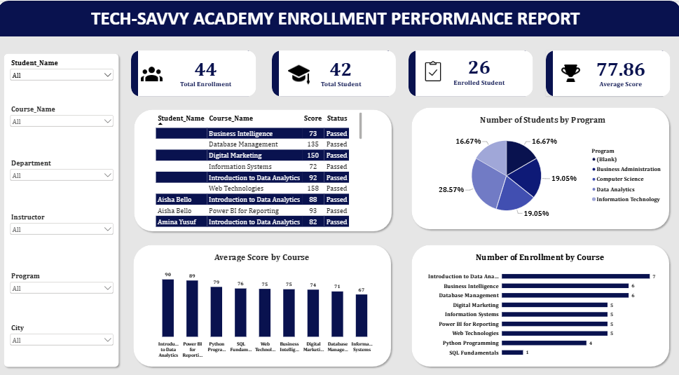

# Tech-Savvy Academy – Enrollment Performance Analysis

## Project Overview

Tech-Savvy Academy is a technology-focused learning institution offering various programmes and courses designed to equip students with relevant digital and technical skills.

This project involves analysing student enrollment and academic performance using Microsoft Power BI. The interactive dashboard provides insights into student enrollment, course participation, average scores, programme distribution, and overall academic performance.

The objective is to transform raw educational data into meaningful insights that can help the academy's management monitor enrollment patterns, evaluate course performance, understand programme distribution, and make informed, data-driven decisions.

## Table of Contents

1. [Dashboard Preview](#dashboard-preview)
2. [Key Performance Indicators](#key-performance-indicators)
3. [Key Business Insights](#key-business-insights)
4. [Recommendations](#recommendations)
5. [Assumptions and Limitations](#assumptions-and-limitations)
6. [How to View the Dashboard](#how-to-view-the-dashboard)
7. [Tools and Technologies](#tools-and-technologies)
8. [Repository Structure](#repository-structure)
9. [Author](#author)

## Dashboard Preview



## Key Performance Indicators

The dashboard highlights four major performance indicators:

| KPI               | Value |
| ----------------- | ----: |
| Total Enrollment  |    44 |
| Total Students    |    42 |
| Enrolled Students |    26 |
| Average Score     | 77.86 |

## Key Business Insights

### 1. Programme Distribution

The programme distribution chart reveals the following:

* Data Analytics leads with 28.57%.
* Business Administration accounts for 19.05%.
* Computer Science also accounts for 19.05%.
* Information Technology contributes 16.67%.
* An additional 16.67% falls under a blank programme category.

Data Analytics has the highest representation among the recorded programme categories. However, the blank category requires further investigation to ensure accurate programme classification.

### 2. Course Enrollment Performance

The course enrollment analysis reveals the following:

| Course                         | Enrollment |
| ------------------------------ | ---------: |
| Introduction to Data Analytics |          7 |
| Business Intelligence          |          6 |
| Database Management            |          6 |
| Digital Marketing              |          5 |
| Information Systems            |          5 |
| Power BI for Reporting         |          5 |
| Web Technologies               |          5 |
| Python Programming             |          4 |
| SQL Fundamentals               |          1 |

Introduction to Data Analytics records the highest enrollment, while SQL Fundamentals has the lowest enrollment.

This could help management identify courses attracting greater student interest and investigate opportunities to improve participation in courses with lower enrollment.

### 3. Average Score by Course

The course performance analysis highlights the following:

| Course                         | Average Score |
| ------------------------------ | ------------: |
| Introduction to Data Analytics |            90 |
| Power BI for Reporting         |            89 |
| Python Programming             |            79 |
| SQL Fundamentals               |            76 |
| Web Technologies               |            75 |
| Business Intelligence          |            75 |
| Digital Marketing              |            74 |
| Database Management            |            71 |
| Information Systems            |            67 |

Introduction to Data Analytics records the highest average score, followed by Power BI for Reporting.

Information Systems records the lowest average score among the courses displayed.

These results provide an opportunity for management to evaluate teaching effectiveness, learning resources, and areas where students may require additional academic support.

### 4. Student Enrollment Records

The dashboard includes a detailed student enrollment table displaying:

* Student Name
* Course Name
* Score
* Enrollment Status

This provides a more detailed view of individual student records and allows management to monitor academic participation and performance.

### 5. Interactive Filtering

The dashboard incorporates interactive slicers that allow users to filter the report using:

* Student Name
* Course Name
* Department
* Instructor
* Programme
* City

These filters support more focused analysis and allow management to explore enrollment and academic performance across different categories.

## Recommendations

1. **Improve Programme Classification:** Investigate the blank programme category and ensure that all student records have accurate programme information.

2. **Strengthen Low-Enrollment Courses:** Investigate the factors responsible for low participation in SQL Fundamentals and consider improving course awareness and accessibility.

3. **Support Underperforming Courses:** Review the teaching approach, learning materials, and assessment methods for Information Systems and Database Management.

4. **Maintain High-Performing Courses:** Identify the teaching and learning practices contributing to the strong performance in Introduction to Data Analytics and Power BI for Reporting.

5. **Monitor Student Enrollment:** Regularly track enrollment figures and student participation to identify changes in demand and improve programme planning.

6. **Improve Data Quality:** Maintain accurate student IDs, enrollment IDs, course records, and programme classifications to support reliable reporting and analysis.

## Assumptions and Limitations

* The dashboard is based on the available student, course, and enrollment datasets.
* The report displays 44 total enrollments and 42 total students.
* The average score of 77.86 represents the overall score indicator displayed on the dashboard.
* The blank programme category indicates records requiring further classification.
* The analysis is descriptive and does not establish the causes of differences in student performance.
* Further investigation would be required to understand the factors influencing course enrollment and academic outcomes.

## How to View the Dashboard

* **Quick Look:** View the dashboard screenshot in the `image` folder.
* **Full Report:** Download the PDF report for a detailed explanation of the findings and recommendations.
* **Interactive Dashboard:** Download the Power BI file from the `powerbi` folder and open it using Microsoft Power BI Desktop.

The interactive slicers allow users to explore the report by student, course, department, instructor, programme, and city.

## Tools and Technologies

* Microsoft Power BI
* Power Query
* Data Cleaning and Transformation
* Data Modelling
* Data Relationships
* Data Visualisation
* Interactive Slicers
* KPI Development
* Business Intelligence and Reporting

## Repository Structure

```text
Tech-Savvy-Academy-Enrollment-Analysis/
│
├── README.md
│
├── powerbi/
│   └── Tech_Savvy_Academy_Report.pbix
│
├── image/
│   └── Tech_Savvy_Academy_Dashboard.png
│
└── report/
    └── Enrollment_Performance_Report.pdf
```

## Author

**Abdulmuiz Abdulazeez Arikewushola**

Data Analyst | Excel | SQL | Power BI | Python

[E-mail](aatorshaw@gmail.com) | [LinkedIn](https://www.linkedin.com/in/torshaw)

---

## About

This project demonstrates the application of Microsoft Power BI in transforming educational data into meaningful insights through data cleaning, data modelling, interactive visualisation, and performance analysis.

It highlights the importance of data-driven decision-making in educational institutions, particularly in monitoring student enrollment, evaluating academic performance, and identifying opportunities for improvement.

**Turning educational data into actionable insights.**
